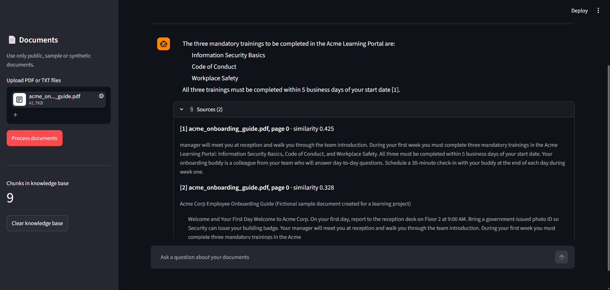
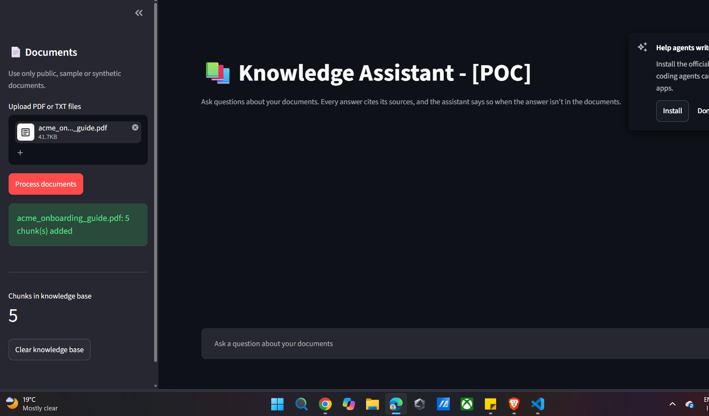
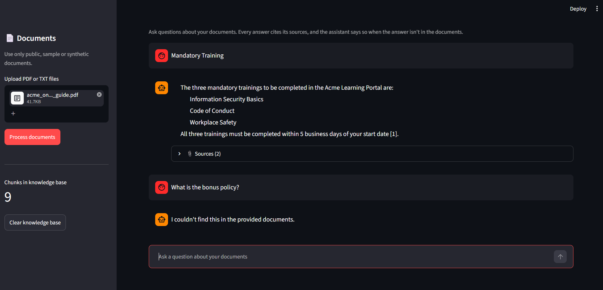

# 📚 Enterprise Knowledge Assistant (RAG)

> Ask questions about company documents and get source-cited answers in seconds.
> When the answer isn't in the documents, the assistant says so instead of guessing.



## Problem
Employees lose time searching long onboarding guides, FAQs and process documents,
and often ask colleagues the same questions again and again.

## Solution
A Retrieval-Augmented Generation (RAG) app. You upload documents, ask questions in
plain English, and get answers grounded in the documents, with the file name and
page number for every source.

## Features
- Upload PDF and TXT files
- Answers with numbered citations (file and page) and expandable source snippets
- "Not found" response when the documents don't contain the answer
- Duplicate-safe ingestion (re-uploading a file doesn't create duplicate chunks)
- Friendly error messages (missing API key, empty or scanned PDFs, API issues)
- Privacy-conscious logging: events only, no questions, document text or keys
- A 20-question evaluation set covering retrieval, answers, citations and refusals

## How It Works
```
Load PDF/TXT (page by page) → Chunk (800 chars, 150 overlap) → Embed (OpenAI)
→ Store in ChromaDB → Embed question → Retrieve top 4 chunks
→ Filter weak matches (score threshold) → Prompt LLM with strict rules → Answer + citations
```

Two layers reduce made-up answers:
1. **Score threshold:** if no chunk is similar enough, the app refuses without calling the LLM.
2. **Strict prompt:** the LLM must answer only from the provided passages, cite them,
   and use a fixed "not found" response otherwise.

## Tech Stack
Python 3.12 · Streamlit · OpenAI API (embeddings + chat) · ChromaDB · pypdf ·
LangChain text splitters · python-dotenv

## Project Structure
```
├── app.py               # Streamlit UI
├── src/
│   ├── config.py        # settings and API key loading
│   ├── loader.py        # PDF/TXT → text with page numbers
│   ├── chunker.py       # overlapping chunks with IDs
│   ├── embeddings.py    # OpenAI embeddings
│   ├── vectorstore.py   # ChromaDB ingest and search
│   ├── rag.py           # prompt, LLM call, citations, not-found handling
│   └── logger.py        # local rotating log
├── eval/
│   ├── questions.csv    # test questions with expected pages
│   └── run_eval.py      # evaluation script
└── data/sample_docs/    # fictional sample document
```

## Evaluation
Tested on 20 questions (15 answerable, 5 not covered by the document).
Settings: chunk <800>/<150>, top_k <4>, min_score <your value>.

| Metric | Result |
|---|---|
| Top-1 retrieval accuracy | <x>/15 |
| Answer correctness | <x>/15 |
| Citations present | <x>/15 |
| Correct refusals | <x>/5 |
| False refusals | <x>/15 |

**What I learned from evaluating:** my first run showed 0/15 retrieval accuracy even
though answers were correct. The cause was my answer key: it assumed a page layout
that didn't match the real PDF. Fixing it taught me to build expected answers from
the actual document.

## Setup (Windows)
```bash
git clone <your-repo-url>
cd enterprise-knowledge-assistant
py -3.12 -m venv .venv
.venv\Scripts\activate
pip install -r requirements.txt
copy .env.example .env      # then add your own OpenAI API key to .env
streamlit run app.py
```

To run the evaluation:
```bash
python -m src.vectorstore ingest data\sample_docs\acme_onboarding_guide.pdf
python -m eval.run_eval
```

## Screenshots
| Upload | Not found |
|---|---|
|  |  |

## Known Limitations
- Each question is answered independently, so follow-up questions don't use earlier context.
- Scanned (image-only) PDFs aren't supported; they would need OCR.
- The evaluation set is small and uses keyword matching, so it's a rough check.
- <Describe your remaining failure, e.g. "One answerable question is refused because its
  similarity score falls just below the threshold.">

## Future Improvements
- Use chat history for follow-up questions
- Re-ranking and hybrid (keyword + semantic) search
- DOCX support
- A 👍/👎 feedback button

## Disclaimer
This project uses only a fictional sample document created for learning.
No confidential, proprietary or client data was used.
